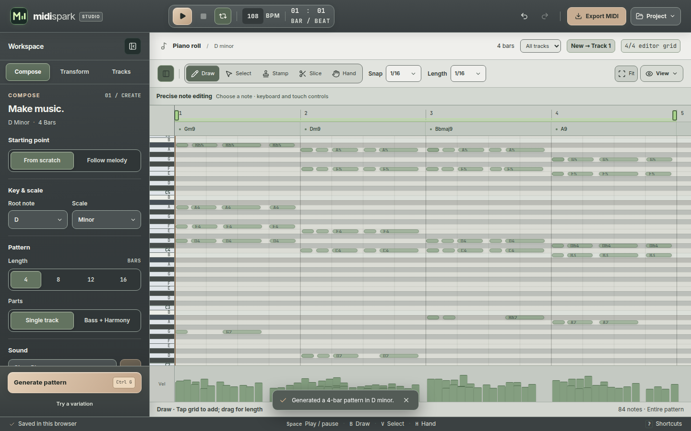
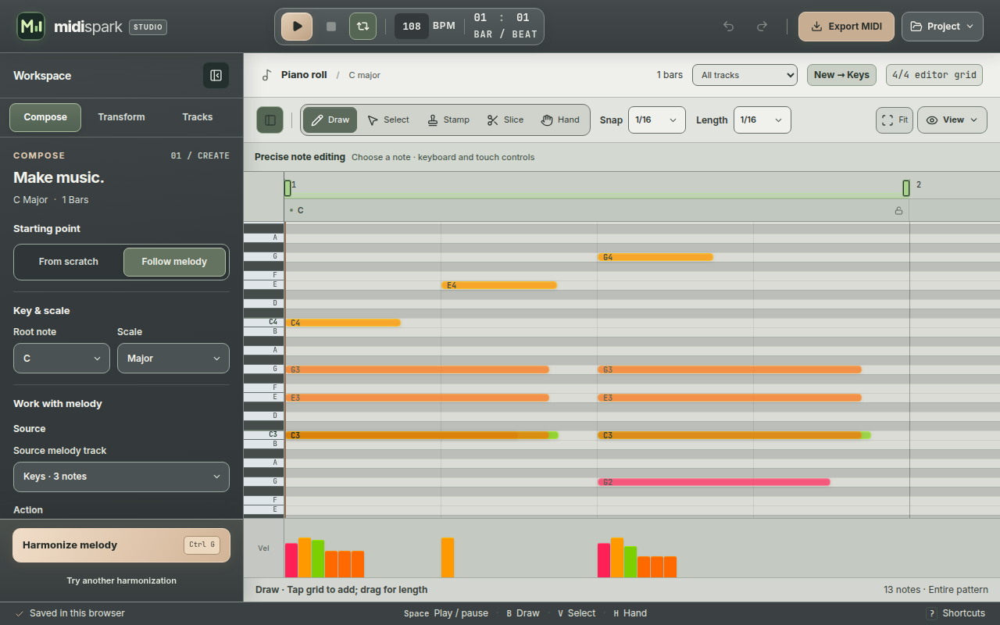
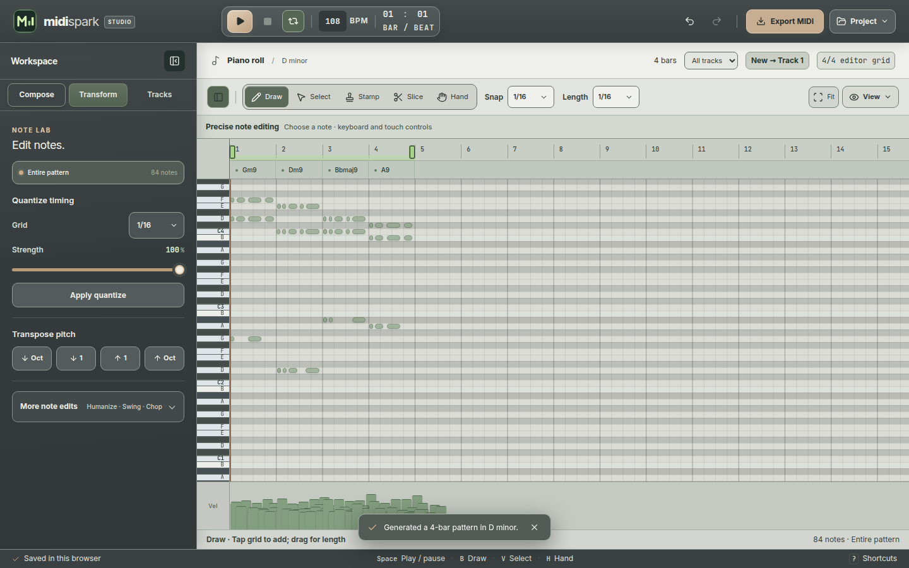
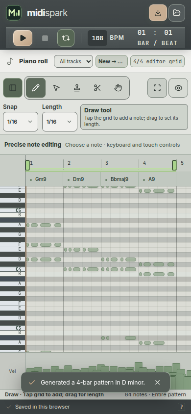
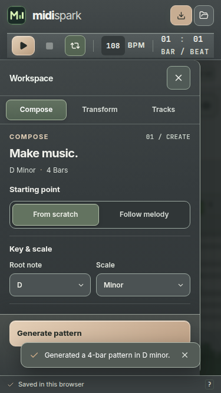
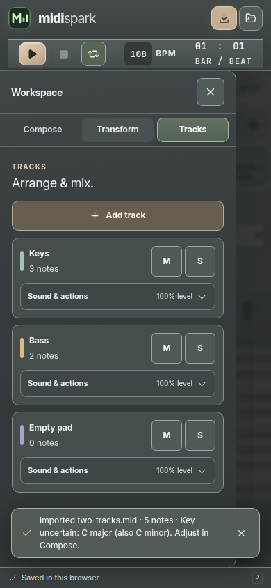
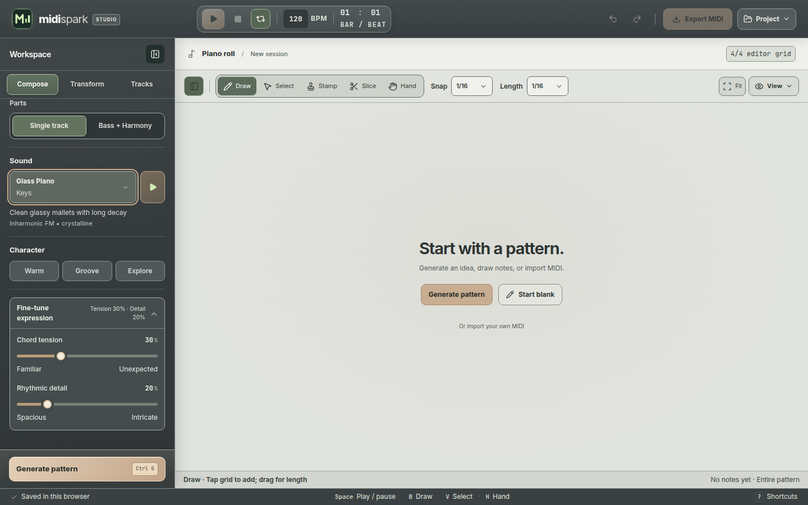

# MIDI Spark

**A browser-based MIDI studio for turning musical ideas into editable patterns, melodies, and arrangements.**

[**Launch MIDI Spark →**](https://dovvnloading.github.io/midi-spark/) · [Explore the source](https://github.com/dovvnloading/midi-spark) · [Report an issue](https://github.com/dovvnloading/midi-spark/issues)

[](https://github.com/dovvnloading/midi-spark/actions/workflows/ci.yml)
[](https://github.com/dovvnloading/midi-spark/actions/workflows/browser-qa.yml)
[](https://github.com/dovvnloading/midi-spark/actions/workflows/deploy-pages.yml)
[](LICENSE)

<p align="center">
  <a href="docs/screenshots/desktop-editor.png">
    
  </a>
</p>

MIDI Spark lets you **generate, harmonize, continue, reimagine, play, and edit MIDI** without leaving the browser. Start with a chord progression, draw notes directly on the piano roll, or import your own melody and build accompaniment around it. Its built-in synths are for immediate listening; your notes remain editable and exportable as standard MIDI.

**No account, cloud processing, or installation required to use the [live app](https://dovvnloading.github.io/midi-spark/).** Musical generation and playback run locally in the browser.

## At a glance

| Compose | Edit | Arrange |
| --- | --- | --- |
| Generate 4–16-bar patterns in major or minor keys | Draw, select, move, resize, slice, stamp, and chop notes | Create, duplicate, rename, focus, mute, and solo tracks |
| Follow an imported or hand-drawn melody | Quantize, transpose, humanize, swing, and edit velocity | Split generated bass and harmony into independent layers |
| Harmonize, continue, or reimagine a phrase | Set snap, note length, loops, and zoom | Audition 49 built-in synth presets and export MIDI |

The UI keeps the essentials in view. **Compose**, **Transform**, and **Tracks** live in the inspector; advanced options open when you need them. **Project** contains import, native project save/open, shortcuts, and browser-storage controls. **Export MIDI** remains in the top bar.

## See the studio

These are **real Chromium captures of the current Slate & Earth interface**, produced by the [browser regression suite](scripts/browser_smoke.py), not concept art. Click any screenshot for its full-size image.

| Follow a melody | Shape the notes |
| :---: | :---: |
| [](docs/screenshots/melody-follow.png) | [](docs/screenshots/note-lab.png) |
| **Follow melody:** derive accompaniment from your notes | **Transform:** tighten timing and edit pitches |

### On smaller screens

| Piano roll | Compose sheet | Tracks & mixer |
| :---: | :---: | :---: |
| <a href="docs/screenshots/mobile-piano-roll.png"></a> | <a href="docs/screenshots/mobile-compose.png"></a> | <a href="docs/screenshots/mobile-tracks.png"></a> |

<details>
<summary>See the first-run empty state</summary>

[](docs/screenshots/empty-state.png)

</details>

## Make your first pattern

1. **Open the [studio](https://dovvnloading.github.io/midi-spark/).** Choose **Generate pattern** in the empty editor, or begin with **Start blank** to draw everything yourself.
2. In **Compose → From scratch**, set a **root key**, **Major/Minor** scale, **length** (4, 8, 12, or 16 bars), and **Single track** or **Bass + Harmony** output.
3. Pick a **Sound** and one of the **Warm**, **Groove**, or **Explore** character presets. Expand **Fine-tune expression** for precise chord tension and rhythmic detail.
4. Press **Generate pattern**. Use **Space** to play/pause and the separate **Stop** control to return to the beginning. If the editor already contains music, replacement requires confirmation.
5. Edit notes in the **piano roll**, switch to **Transform** or **Tracks**, then choose **Export MIDI** when ready. Use **Project → Save MIDI Spark project** if you want to preserve the whole editable studio session.

**Tip:** Click **Fit** above the piano roll to frame the current pattern. Use **View** for optional zoom and playback-follow settings.

## Compose from a melody

Choose **Compose → Follow melody** to work with a phrase you already have:

1. **Create or import a source.** Draw notes on a new track, or use **Project → Import MIDI**. Choose the source melody track if the file contains multiple tracks.
2. **Pick the source phrase.** Work from the complete source track, selected notes, or a timeline loop. On touch screens, **Follow melody → Loop range** provides From/Through bar controls instead of requiring a Shift-drag.
3. **Choose the creative operation.**
   - **Harmonize** generates separate **Generated Bass** and **Generated Harmony** tracks fitted to the melody.
   - **Continue** extends its contour and rhythm into a new **Melody Continuation** track.
   - **Reimagine** creates a related alternative on a **Melody Variation** track, leaving the original intact.
4. **Refine the result.** Adjust harmonic fit, chord-change pacing, accompaniment motion, key strategy, and creative distance. More specialized settings are tucked into **Advanced harmony/melody options**.
5. **Compare before accepting.** After harmonizing, **Take Lab** can explore three alternative accompaniments, audition and compare their chord changes, and save up to four favorites. Previewing a take does not change the MIDI export; **Accept selected take** commits it as an undoable edit.

For harmonization, use the **padlock in the chord lane** to keep a generated chord *and its bass/harmony notes* unchanged during regeneration. **Chord guide** can pin or exclude chords before generation; unlike a padlock, a guide does not preserve previously generated note events.

The source melody and unrelated user-owned tracks are protected during these operations. Regenerating a generated part replaces the corresponding generated material; **duplicate a generated track first** if you want to preserve edits to it.

Learn about the search, phrase constraints, seeded behavior, and limits in [Melody-conditioned composition](docs/ADAPTIVE_MELODY.md).

## Edit in the piano roll

| Tool | What it does |
| --- | --- |
| **Draw (B)** | Click or drag to place notes; drag to set a duration |
| **Select (V)** | Select individual notes or lasso a group, then move or resize them |
| **Stamp (S)** | Insert chord or scale patterns |
| **Slice (C)** | Split notes; **Chop** subdivides notes into shorter pieces |
| **Hand (H)** | Pan the timeline without editing notes |

Use the **velocity lane** below the grid to change the intensity of notes; the precision note editor also supports keyboard access and numeric pitch/timing/velocity edits. Set the **snap grid** from quarter notes to 1/32 notes (or free placement), and use **Duplicate Bar** plus copy/paste to build longer ideas.

**Transform** offers undoable cleanup tools:

- **Quantize:** pull note starts toward a grid at adjustable strength, without changing their durations.
- **Transpose:** shift by semitone or octave.
- **Humanize:** add controlled timing and velocity variation.
- **Swing / reshape:** change groove and note expression through optional controls.

When notes are selected, transforms target that selection. Otherwise they apply to the focused track, or all visible notes in **All tracks** view. Undo/redo works across these edits.

### Timeline and playback

The ruler lets you seek and set a repeatable loop. **Shift-drag** a range, drag its handles (including on touch), or focus a handle and use the arrow keys. Double-click the ruler to restore the full-pattern loop. Loop and view preferences are saved locally; ordinary MIDI export does not encode the app's custom loop UI state.

## Build and hear a multitrack idea

Open **Tracks** to add empty tracks, manage existing ones, and focus one lane in the editor. Each track offers:

- An independently selectable built-in synth sound, level, mute, and solo.
- Rename, duplicate, and delete actions; deleting a populated track requires confirmation.
- Focused-lane note editing so pasted, drawn, stamped, or transformed notes target the intended part.

MIDI Spark includes **49 synthesized instrument presets** across multiple timbres. These are browser playback sounds, not downloadable sample libraries or VST plugins. Track levels, solos, and browser sound choices shape the live preview; they do not render audio into an exported `.mid` file.

For longer arrangements, **Song structure** can expand suitable 4- or 8-bar ideas into labeled song sections. The generator and accompaniment engine support repeatable seeded test cases, but ordinary generation is intentionally varied.

## Save, export, and privacy

| Option | What you get |
| --- | --- |
| **Export MIDI** | Standard `.mid` note data and compatible track/program information for a DAW or other MIDI tool |
| **Project → Save MIDI Spark project** | A `.midispark` project containing notes, tracks, generated-part metadata, chord guides and locks, saved takes, mixer and project settings |
| **Project → Open MIDI Spark project** | Restore that native project session |
| **Project → Import MIDI** | Bring in a MIDI file for editing or as a source melody |
| **Browser autosave** | Local restoration of your working session on the same browser/profile; this is **not** cloud sync or a backup |

**MIDI is not audio.** Exported files contain performance data, not MIDI Spark's Tone.js synth timbres or effects. In other apps, sounds depend on the destination instrument and General MIDI program mapping. Native `.midispark` projects preserve MIDI Spark-specific settings; MIDI export does not preserve Take Lab favorites, generated-track ownership, chord guides, or studio-only loop/mixer data.

Use **Save MIDI Spark project** or **Export MIDI** before clearing site data or moving devices. If browser storage fails, the status bar reports it instead of claiming a successful save. The app does not upload your compositions to a server.

## Shortcuts and gestures

| Shortcut | Action |
| --- | --- |
| `Space` | Play / pause |
| `Ctrl/⌘ + G` | Generate / regenerate |
| `B` / `V` / `S` / `C` / `H` | Draw / Select / Stamp / Slice / Hand |
| `F` | Fit pattern |
| `Ctrl/⌘ + Z` · `Ctrl/⌘ + Shift + Z` | Undo · redo |
| `Ctrl/⌘ + A` | Select notes in the focused lane |
| `Ctrl/⌘ + C` / `Ctrl/⌘ + V` | Copy / paste notes at the playhead |
| `Delete` / `Backspace` | Delete selected notes |
| `Alt + U` | Chop notes |
| `Ctrl/⌘ + wheel` / `Shift + wheel` | Zoom at pointer / horizontal scroll |
| `Shift + drag ruler` | Define a timeline loop |
| `?` | Open the in-app shortcuts and gestures guide |
| `Esc` | Clear selection or close an open panel |

Shortcuts apply when the editor has focus; typing into a form field preserves normal input behavior.

## Run locally

**Requirements:** Node.js **20+** and npm.

```bash
git clone https://github.com/dovvnloading/midi-spark.git
cd midi-spark
npm ci
npm run dev
```

Open **http://localhost:3000**. The production bundle is static and deploys to GitHub Pages.

| Command | Purpose |
| --- | --- |
| `npm run dev` | Vite dev server (port 3000) |
| `npm run build` | Build into `dist/` |
| `npm run preview` | Preview the production build |
| `npm run typecheck` | Strict TypeScript checks |
| `npm run lint` | ESLint |
| `npm test` | Vitest suites |
| `npm run eval:music` | Reproducible symbolic-music benchmark |
| `npm run eval:compare -- before.json after.json` | Compare benchmark reports |

### Browser checks and screenshot sources

The [browser QA workflow](.github/workflows/browser-qa.yml) exercises the production app in Chromium at desktop and mobile widths, including pointer/touch interactions, import/export, persistence, editing, menus, and accessibility-oriented behavior. It uploads screenshots and geometry as a **browser-review** workflow artifact. The screenshots above are curated from those actual captures; see the [capture manifest](docs/screenshots/README.md) for the exact source run, viewport sizes, and re-capture procedure.

To generate the complete evidence set locally, run the production preview in one terminal, then in another:

```bash
# From the repository root after npm ci
npm run build
npm run preview -- --host 127.0.0.1 --port 4173

# In another terminal (Python 3.11+)
python -m pip install playwright==1.57.0
python -m playwright install chromium
python scripts/browser_smoke.py --url http://127.0.0.1:4173 --output browser-report
```

Set `CHROMIUM_PATH` if using a system Chrome/Chromium binary. These are automated Chromium/browser-emulation checks, not physical-device or cross-browser certification.

## Tech and further reading

Built with **React 19**, **TypeScript**, **Vite 6**, **Tailwind CSS 4**, **Tone.js 15**, **Tonal**, and **@tonejs/midi**. The UI theme is described in [Slate & Earth](docs/SLATE_EARTH_THEME.md); code is organized into `src/components/`, music/audio/file logic in `src/lib/`, and tests in `tests/`.

- [Adaptive melody engine: behavior and constraints](docs/ADAPTIVE_MELODY.md)
- [Sound design and synthesis](docs/SOUND_DESIGN.md)
- [Music-quality research and benchmark methodology](docs/MUSIC_RESEARCH_EVALUATION_2026.md)
- [Generation roadmap](docs/FRONTIER_GENERATION_ROADMAP.md)

**Current boundaries:** This is symbolic MIDI composition, **not** audio-to-MIDI transcription or a pretrained generative-music service. The piano-roll timeline is **4/4**; an imported file with a different time signature receives a warning rather than silently changing the editor grid. Audio playback requires browser Web Audio support and an initial user gesture.

## License

[MIT](LICENSE) · Created by Matthew Wesney.
